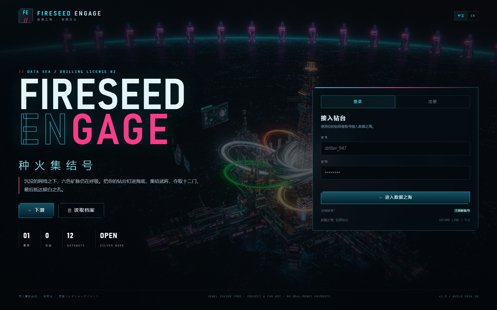
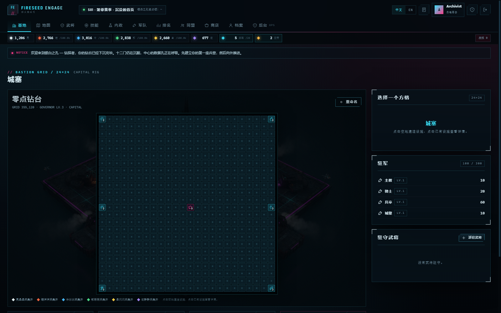
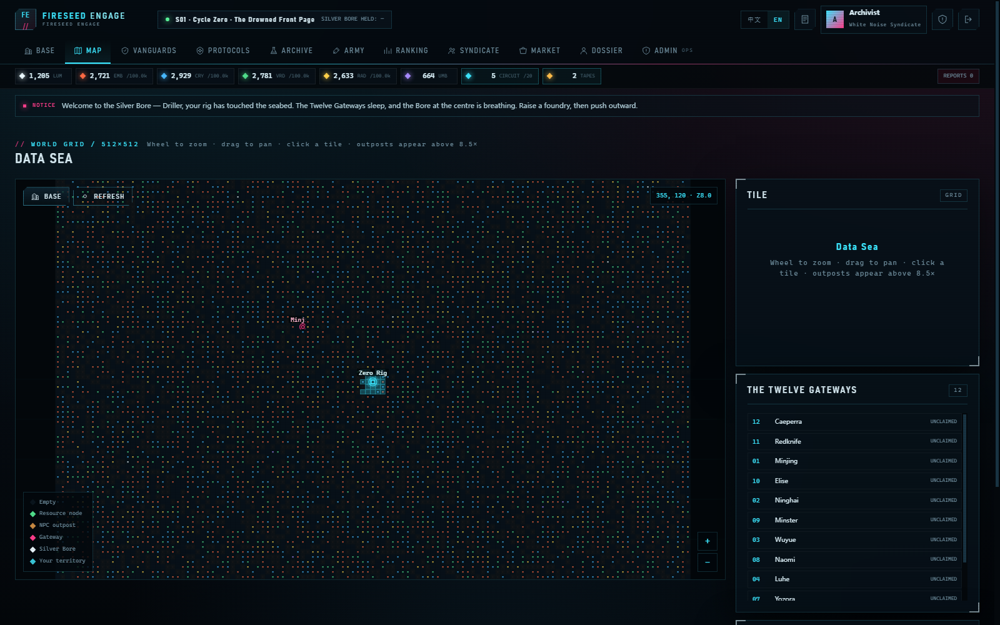
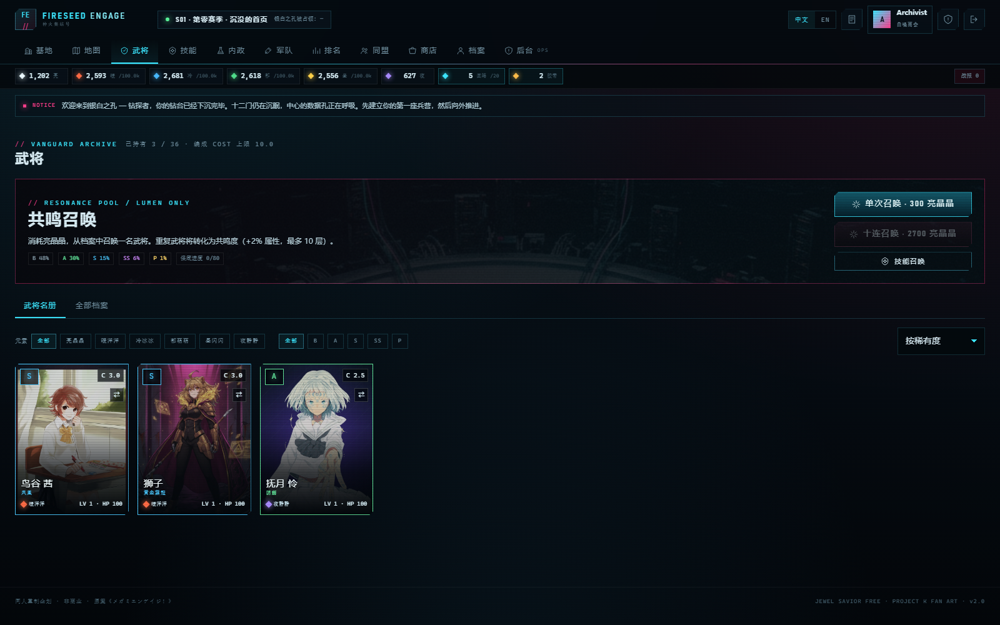
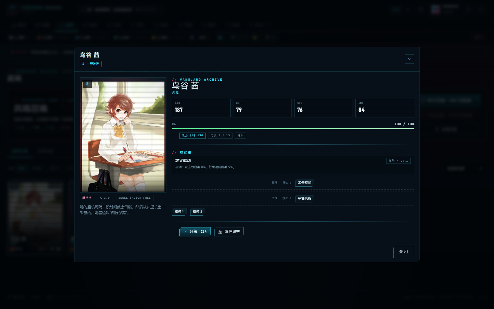
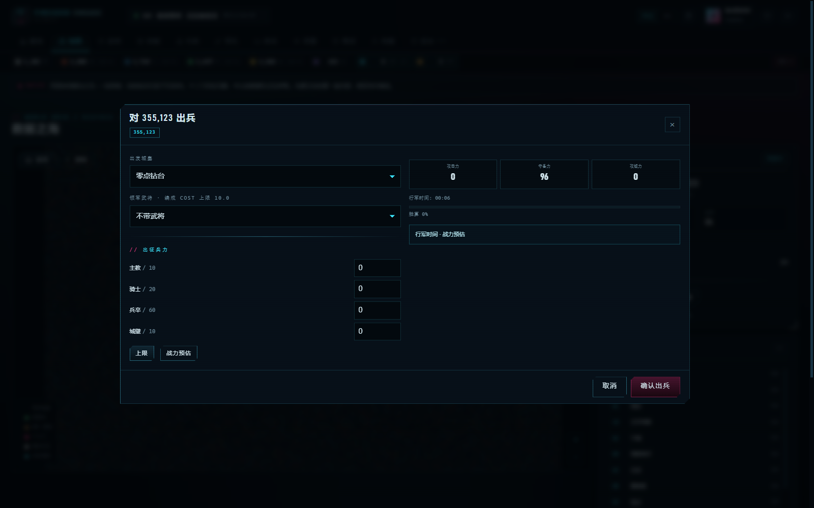
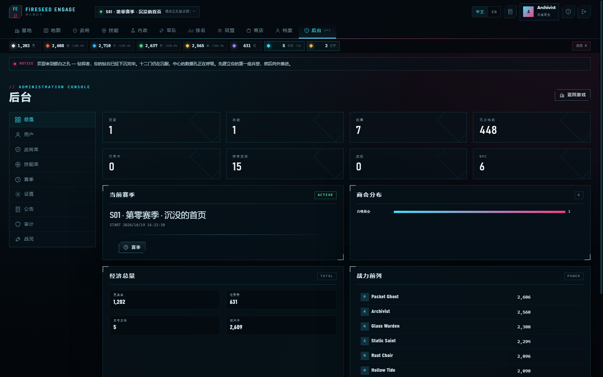
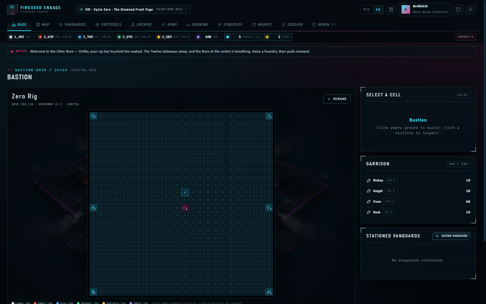

# 种火集结号 / FIRESEED ENGAGE

一款可在浏览器中游玩的**合成器朋克（synthpunk）数据海战略游戏**：建造钻台城塞、经营六色资源、召唤武将、研究科技、占领领地，最终夺取地图中央的**银白之孔**。

A browser-based **synthpunk data-sea strategy game**: build a drilling-rig bastion, manage six resource currents, summon Vanguards, research technology, claim territory, and take the **Silver Bore** at the centre of the world.

本项目是对 2012–2017 年日本网页游戏《メガミエンゲイジ！》的**非商业同人重制**。虚构层、术语与部分系统按 `designasset/initial-setting.txt` 与 `initial-beta-readiness-spec` 的魔改设定重新创作；不使用原作的日文术语、日月星阵营或原作角色卡图。

This is a non-commercial fan remake of the discontinued Japanese browser game *Megami Engage!*. Its fiction, terminology and several systems are rebuilt from the user-provided redesign documents. It does not reuse the original game's Japanese terminology, sun/moon/star factions, or character card art.

## 预览 / Preview

| | |
| --- | --- |
|  |  |
| 登录/注册 | 24×24 城塞网格 |
|  |  |
| 512×512 数据海地图 | 武将卡册 |
|  |  |
| 武将详情与技能槽 | 出兵编成与战力预估 |
|  |  |
| 后台总览 | 英文界面 |

---

## 快速开始 / Quick start

### 环境 / Requirements

- **Node.js 24 或更新版本**（使用内置 `node:sqlite`，无需 `npm install`）
- 现代浏览器（Chromium / Firefox / Safari 的较新版本）
- 无需 PHP、MySQL 或构建步骤

- **Node.js 24+** (uses built-in `node:sqlite`; no `npm install` needed)
- A modern browser
- No PHP, MySQL, or build step

### 启动 / Run

```powershell
# 在项目根目录 / from the repository root
node server.mjs
```

打开 <http://127.0.0.1:8080>。

第一次启动会生成 512×512 的世界（约 262,144 个地块）与全部种子内容，通常需要 **20–40 秒**。之后启动是即时的。

首次启动会创建管理员账号：

- 用户名：`admin`
- 密码：`fireseed`

**请立即在后台 → 用户 → 管理员详情中重置密码。** 也可以通过环境变量指定初始密码：

```powershell
$env:FIRESEED_ADMIN_PASSWORD = "a-long-random-password"
node server.mjs
```

可用环境变量：

| 变量 | 默认 | 说明 |
| --- | --- | --- |
| `PORT` | `8080` | HTTP 端口 |
| `HOST` | `127.0.0.1` | 监听地址；公网部署时建议放在反向代理后 |
| `FIRESEED_DB` | `./data/fireseed.db` | SQLite 数据库路径 |
| `FIRESEED_ADMIN_PASSWORD` | `fireseed` | 首次种子管理员密码 |
| `SESSION_DAYS` | `14` | 会话有效期 |
| `NODE_ENV` | — | 设为 `production` 时隐藏调试输出 |

### 重置 / Reset

```powershell
# 停止 node server.mjs 后
node tools/reset.mjs
node server.mjs
```

`tools/reset.mjs` 只删除 `data/fireseed.db*`；不会删除代码、卡图或用户上传以外的资源。`public/assets/generals/admin_*` 是后台上传的卡图，需要手动清理。

### 冒烟测试 / Smoke test

```powershell
# 服务器运行中 / with the server running
node tools/smoke.mjs
```

---

## 玩法 / How to play

1. **基地（Base）**：在 24×24 城塞网格上建造兵营、研究所、宿舍、贮存所、瞭望台、工程所；升级六色采集井与总督府。
2. **地图（Map）**：滚轮缩放、拖拽平移。占领与自己领地邻接的空地；资源点需要派兵攻占并消耗**思考回路**；NPC 前哨需要先消灭守军，再用**锤子兵**打穿耐久。
3. **武将（Vanguards）**：用**亮晶晶**召唤。每名武将有一个固有技能与两个可装备技能槽；重复武将转为共鸣度（+2% 属性，最多 10 层）。
4. **技能（Protocols）**：用**夜静静**抽取技能卡。同名卡用于升级；主动技能有冷却时间，被动技能在驻扎/出征时自动生效。
5. **内政（Archive）**：研究所等级决定赛季科技上限。赛季科研消耗四色资源并在赛季结束重置；永久科研消耗亮/夜并跨赛季保留。
6. **军队（Army）**：兵营训练兵卒/骑士/城壁/主教，工程所训练锤子兵，瞭望台训练侦察兵。出兵需要选择城塞、武将与兵力。
7. **同盟（Syndicate）**：创建或加入同盟；同盟成员与附庸之间不能互相攻击。世界频道可聊天。
8. **商店（Market）**：没有真实付费货币。所有物品仅用游戏内获得的亮晶晶/夜静静购买。
9. **季节（Cycle）**：占领十二门之一后可进攻银白之孔；持续占领达到配置时间即获胜。赛季结束后，账号、武将、技能卡、亮晶晶、夜静静、计时胶带、永久科研与同盟保留；地图、城塞、设施、部队、领地、赛季科研与四色资源重置。

详细机制与公式见 [`doc/design-rework.md`](doc/design-rework.md)。

---

## 后台 / Administration

访问 `/#/admin`（需要 `admin` 角色）：

- **总览**：玩家、在线、城塞、领地、行军、战报、经济总量、商会分布、战力榜。
- **用户**：搜索、查看详情、改角色/状态、发放货币、重置密码、封禁。
- **武将库**：新建/编辑/复制/停用武将；中英双语名称、称号、来源、稀有度、COST、元素、四维、卡图 URL/上传、固有技能、卡池权重、档案。
- **技能库**：新建/编辑/停用技能；类型、元素、冷却、持续时间、效果 JSON、卡池权重。
- **赛季**：查看历史、修改胜利占领时间、立即结束、**原子重建新赛季**（带 `REBUILD` 二次确认）。
- **设置**：地图尺寸、资源速率、思考回路周期、NPC 强度、注册开关、人数上限、维护模式、初始资源、卡池价格/概率/保底、建造/研究/训练/行军倍率、离线结算上限、赛季奖励等。
- **公告**、**审计日志**、**战况**（全部行军与战报）。

> 后台的武将/技能编辑器就是“任意重现原作每一张武将卡”的入口：所有字段都是显式数据，不依赖代码里的硬编码角色。

---

## 技术结构 / Architecture

```
server.mjs                 HTTP 入口、种子检查、后台 tick
server/
  config.mjs               元素、兵种、设施、商会、默认设置
  schema.sql               SQLite 表结构
  db.mjs                   node:sqlite 封装、设置、事务
  world.mjs                世界生成、城池创建、内容种子
  engine.mjs               资源结算、科技修正、技能被动、战力
  combat.mjs               行军、战斗、侦察、占领、附庸
  actions.mjs              游戏动作与序列化
  season.mjs               赛季重建、胜利判定
  routes-game.mjs          玩家 API
  routes-admin.mjs         后台 API
  content.mjs              24 个技能、22 项科技、任务、商店
  roster.mjs               36 名武将的元数据与属性生成
public/
  index.html
  css/style.css
  js/                      SPA（原生 ES modules，无构建）
  assets/generals/         武将卡图（webp）
  assets/bg/               主视觉/城塞/银白之孔
data/fireseed.db           SQLite（首次启动创建）
doc/                       设计、研究、运维文档
tools/                     种子/测试/截图/资产准备脚本
```

**为什么是 Node + SQLite**：单进程、零依赖、单文件数据库、备份和迁移简单；适合内测规模（默认上限 50 人）与低维护成本。所有时间推进在进程内 tick + 请求时结算，不依赖外部 cron。

---

## 部署 / Deployment

### Windows（IIS / 独立进程）

1. 安装 Node.js 24+。
2. 将仓库放在例如 `D:\Fireseed`。
3. 在项目根目录运行 `node server.mjs`，或使用 NSSM / 任务计划程序注册为服务。
4. 若通过 IIS 反向代理，请把站点绑定到 `http://127.0.0.1:8080`，并设置 `X-Forwarded-Proto: https`（应用用它给会话 cookie 加 `Secure`）。
5. 只对可信网络开放；生产环境建议在 IIS 层启用 HTTPS 与访问限制。

### Linux（systemd + Caddy/Nginx）

```ini
# /etc/systemd/system/fireseed.service
[Unit]
Description=Fireseed Engage
After=network.target

[Service]
Type=simple
User=fireseed
WorkingDirectory=/srv/fireseed
Environment=HOST=127.0.0.1
Environment=PORT=8080
Environment=FIRESEED_DB=/var/lib/fireseed/fireseed.db
ExecStart=/usr/bin/node server.mjs
Restart=on-failure
RestartSec=5

[Install]
WantedBy=multi-user.target
```

```bash
sudo systemctl daemon-reload
sudo systemctl enable --now fireseed
```

Caddy 示例：

```caddy
game.example.com {
    reverse_proxy 127.0.0.1:8080
    header {
        X-Content-Type-Options nosniff
        X-Frame-Options DENY
        Referrer-Policy same-origin
    }
}
```

> 应用自身已发送 CSP、`X-Frame-Options`、`nosniff` 等响应头。反向代理必须保留它们，或在代理层设置等价规则。

### 反向代理注意

- 应用把 `x-forwarded-proto: https` 作为 cookie `Secure` 的判断依据；只有可信代理可以设置该头。
- 建议把 `data/` 与 `public/assets/generals/admin_*` 排除在公开静态目录之外；本应用只暴露 `public/`，`data/` 不在静态根内。
- 生产环境不要使用默认管理员密码。

---

## 备份、迁移与维护 / Backup & maintenance

### 备份

SQLite 使用 WAL。最稳妥的方式是短暂停机后复制：

```powershell
Stop-Service fireseed        # 或停止 node 进程
Copy-Item data\fireseed.db data\backups\fireseed-$(Get-Date -Format yyyyMMdd-HHmm).db
Start-Service fireseed
```

也可以使用 SQLite 的在线备份（例如 Python `sqlite3.Connection.backup` 或 `sqlite3 .backup`）而不停机。备份应包含 `data/fireseed.db`；WAL/SHM 在停机后会合并。

### 赛季

后台 → 赛季：

1. 可选：修改胜利占领天数（支持小数，内测可用 0.01 天）。
2. 在“原子重建”区域输入 `REBUILD`、填写新赛季名称，点击重建。
3. 重建是单事务：任何失败会回滚并保留旧世界；成功后旧赛季标记为 `ended`，新世界与所有玩家主城重新生成。

**保留**：账号、亮晶晶、夜静静、武将、武将等级/共鸣、技能卡与等级、计时胶带、永久科研、同盟本体/成员/职位。
**重置**：四色资源、思考回路、城塞、设施、部队、军队、领地、分基地、赛季科研、任务进度、战报、赛季积分。

### 更新

1. 停止进程并备份 `data/`。
2. 替换代码（保留 `data/` 与 `public/assets/generals/` 中的上传文件）。
3. 启动。`schema.sql` 使用 `CREATE TABLE IF NOT EXISTS`，适合全新安装；已有数据库的字段变更需要手工迁移或在预发布环境验证后执行 SQL。
4. 运行 `node tools/smoke.mjs` 并检查后台。

### 监控建议

- 进程存活：systemd `Restart=on-failure` / NSSM。
- 日志：stdout/stderr 交给 journald 或文件轮转。
- 磁盘：SQLite 文件与 WAL 会增长；定期备份并 `VACUUM`（停机时）。
- 备份恢复演练：至少每赛季前做一次。

---

## 测试 / Tests

```powershell
node tools/smoke.mjs          # 健康检查、引导包、静态页、未登录 401
node tools/api-test.mjs       # 登录、城塞、地图、武将、研究、商店、战报
node tools/e2e-api.mjs        # 建造、训练、研究、占点、战斗
node tools/full-test.mjs      # 注册、抽卡、同盟、聊天、后台 CRUD、赛季重建（会改动数据库）
```

`full-test.mjs` 会创建一个测试账号并触发赛季重建；请只在开发库运行。测试后可用 `node tools/reset.mjs` 重置。

---

## 资产与授权 / Assets & attribution

- **Jewel Savior FREE（ジュエルセイバーFREE）**：24 名武将的立绘来自 `jewel-s-free101j`，依其免费内容条款使用。作品内与本文档均保留标题与 URL：
  - Title: [ジュエルセイバーFREE] / [JewelSaviorFREE]
  - URL: <http://www.jewel-s.jp/>
- **ProjectK / 《动物朋友3》角色资料**：12 名武将的角色灵感来自 `ProjectK` 的《动物朋友3》角色档案；卡图为本项目使用生成式图像工具重新绘制的同人再创作，**未复用游戏原始资产**，仅以角色立绘作为参考。角色与《动物朋友》相关权利归其权利方所有。
- **原案**：《メガミエンゲイジ！》© G-MODE / ONE-UP / Marvelous 及各自权利方。本项目为非商业同人重制，与上述公司无关联。
- **AI 生成图**：主视觉、城塞背景、银白之孔与 12 张 ProjectK 武将卡图由 Gemini 2.5 Flash Image 生成；生成提示词与来源记录见 [`doc/asset-provenance.md`](doc/asset-provenance.md)。

完整的第三方声明见 [`NOTICE.md`](NOTICE.md)。

---

## 已知边界 / Known limitations

- 内测规模：单 Node 进程 + SQLite，默认最多 50 名玩家；不适合大规模并发。
- 没有原作后期玩法（Raid、Arena、Battle Tower）的完整复刻；本项目聚焦魔改文档中的核心循环。
- 地图为 512×512 抽象网格，不是原作等距视角的完整视觉复刻；界面采用 synthpunk 风格重新设计。
- 战斗是确定性结算（无逐帧动画），战报以文本与数值呈现。
- 没有实时 WebSocket；前端每 6 秒轮询状态，行军到达由服务端 tick 结算。
- 部分数值为内测临时基线（NPC 强度、建造/研究/训练加速），可在后台调整；不是最终平衡。
- 没有内置邮件/找回密码；管理员可在后台重置密码。

---

## 文档 / Documentation

- [`doc/design-rework.md`](doc/design-rework.md)：魔改后的世界观、术语、系统与公式。
- [`doc/admin-guide.md`](doc/admin-guide.md)：后台操作与数据字段说明。
- [`doc/original-research.md`](doc/original-research.md)：原作资料、来源与复刻取舍。
- [`doc/asset-provenance.md`](doc/asset-provenance.md)：图像生成与素材来源。
- [`doc/operations.md`](doc/operations.md)：部署、备份、赛季运维清单。

---

*“钻入沉没的数据之海，唤醒银白之孔。”*
